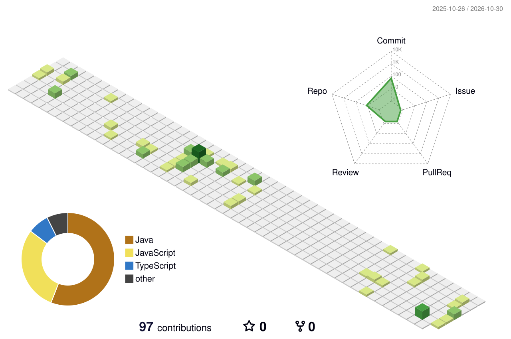

# Alan | Desenvolvedor Back-end

Desenvolvedor back-end com foco em **TypeScript/Node.js** e **Java/Spring Boot**. Construo APIs, microserviços e processamento em lote, e levo tudo até o deploy na nuvem. Também trabalho no front quando o projeto precisa.

 

## Stack

**Back-end**

**Nuvem, containers e versionamento**

Na AWS: Lambda, Batch, SQS, SNS, S3, API Gateway, CloudWatch, Athena e Data Lake.

**Bancos de dados**

Também uso SQL Server e tenho noções de MongoDB e DynamoDB.

**Front-end**

Angular no dia a dia do trabalho, com noções de React e Next.js.

 

## Experiência

**Estagiário de Desenvolvimento | Brasilcap** (grupo BB Seguros)
_Mai 2026 até hoje_

Desenvolvimento com Node.js e TypeScript, microserviços na AWS e containers com Docker. No front, trabalho com Angular.

**Estagiário de Desenvolvimento | Tecal**
_Set 2025 a Mai 2026_

Desenvolvimento back-end com Java e Spring Boot.

 

## O que eu já fiz

- **Aplicações completas**, do banco de dados à API, incluindo autenticação, regras de negócio e deploy
- **Microserviços** em Node.js/TypeScript e em Java com Spring Boot
- **Jobs em lote** com AWS Batch: desenvolvimento, execução e ajuste de agendamentos e triggers
- **Funções Lambda** e integrações na AWS com SQS, SNS, S3 e API Gateway
- **Consultas e análise de dados** com Athena sobre Data Lake
- **Monitoramento e logs** com CloudWatch

 

## Atividade

  

 

## Sobre meus repositórios

Os projetos públicos aqui são só uma parte do que já fiz. Boa parte do meu trabalho está em repositórios privados, então os fixados abaixo são uma amostra.

 

## Contato

Estou aberto a vagas e a conversas sobre projetos. Pode me chamar por aqui:

