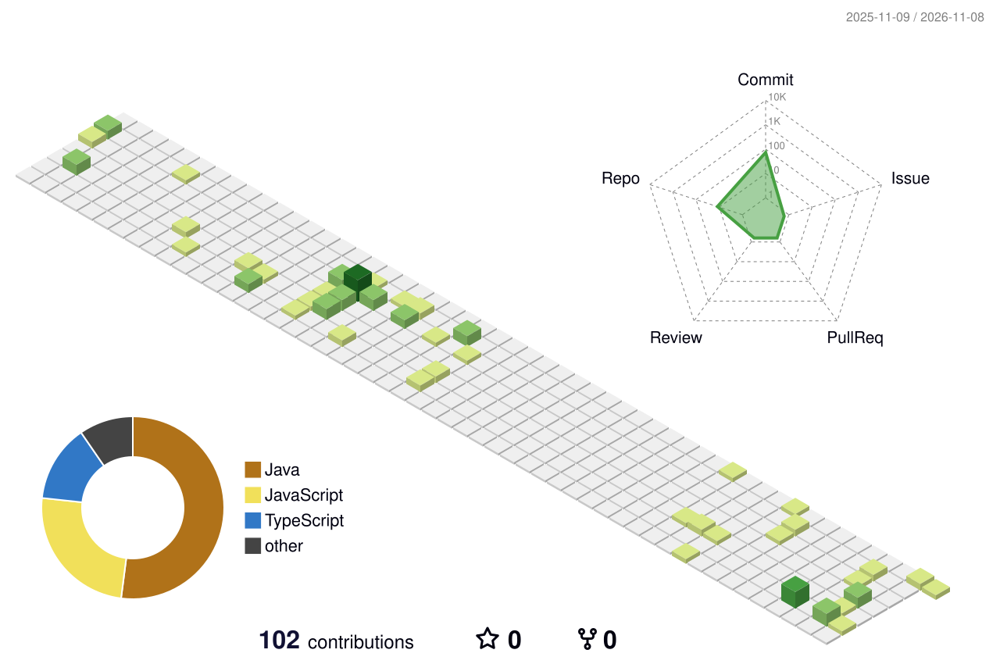

 

 

Construo APIs, microserviços e processamento em lote, e levo tudo até o deploy na nuvem. 
Também trabalho no front quando o projeto precisa.

## Stack

<table>
  <tr>
    <td valign="top" width="50%">
      <b>Back-end</b>  
      
    </td>
    <td valign="top" width="50%">
      <b>Nuvem, containers e versionamento</b>  
       
      Lambda, Batch, SQS, SNS, S3, API Gateway, CloudWatch, Athena, Data Lake
    </td>
  </tr>
  <tr>
    <td valign="top" width="50%">
      <b>Bancos de dados</b>  
       
      Também SQL Server. Noções de MongoDB e DynamoDB.
    </td>
    <td valign="top" width="50%">
      <b>Front-end</b>  
       
      Angular no dia a dia. Noções de React e Next.js.
    </td>
  </tr>
</table>

## Experiência

<table>
  <tr>
    <th align="left">Período</th>
    <th align="left">Onde</th>
    <th align="left">O que eu fiz</th>
  </tr>
  <tr>
    <td><b>Mai 2026 até hoje</b></td>
    <td><b>Brasilcap</b> Grupo BB Seguros Estagiário de Desenvolvimento</td>
    <td>Node.js e TypeScript, microserviços na AWS, containers com Docker. No front, Angular.</td>
  </tr>
  <tr>
    <td><b>Set 2025 a Mai 2026</b></td>
    <td><b>Tecal</b> Estagiário de Desenvolvimento</td>
    <td>Back-end com Java e Spring Boot.</td>
  </tr>
</table>

## O que eu já fiz

- **Aplicações completas**, do banco de dados à API, incluindo autenticação, regras de negócio e deploy
- **Microserviços** em Node.js/TypeScript e em Java com Spring Boot
- **Jobs em lote** com AWS Batch: desenvolvimento, execução e ajuste de agendamentos e triggers
- **Funções Lambda** e integrações na AWS com SQS, SNS, S3 e API Gateway
- **Consultas e análise de dados** com Athena sobre Data Lake
- **Monitoramento e logs** com CloudWatch

## Atividade

  

Os projetos públicos aqui são só uma parte do que já fiz. Boa parte do meu trabalho está em repositórios privados, então os fixados abaixo são uma amostra.

### Vamos conversar?

Aberto a vagas e a conversas sobre projetos.

